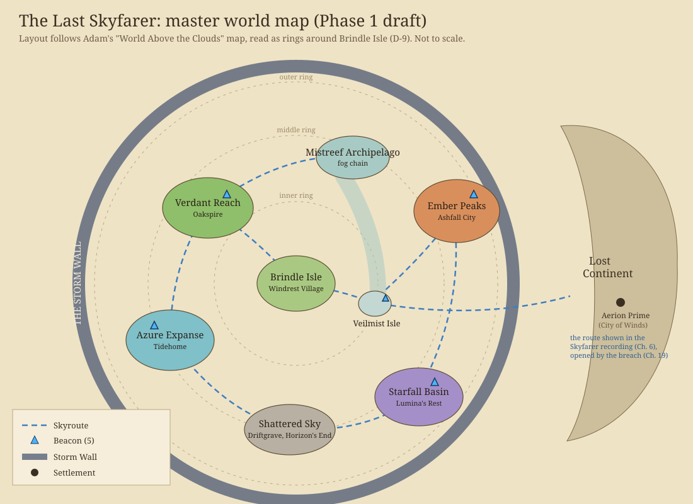

# Master World Map (Phase 1 draft)

Source: [world_map.svg](world_map.svg) (editable). Built from Adam's "The Last Skyfarer: World Above the Clouds" map, read as concentric rings around Brindle Isle (D-9). Distances are relative; real scale is set in the Phase 2 technical plan.

## Layout

| Ring | Region | Position (from Brindle) | Settlement | Beacon | Acts |
|---|---|---|---|---|---|
| Centre | Brindle Isle | Centre | Windrest Village | None | I, revisits |
| Inner | Mistreef Archipelago, with Veilmist Isle | Veilmist just east of Brindle, hidden in fog; the chain curves north | None | Veilmist | I |
| Inner | Verdant Reach | North-west | Oakspire | Verdant | II |
| Middle | Ember Peaks | East | Ashfall City | Ember | II |
| Middle | Azure Expanse | South-west | Tidehome | Azure | II |
| Outer | Shattered Sky | South | Driftgrave; Horizon's End on its outer edge | None | III |
| Outer | Starfall Basin | South-east | Lumina's Rest | Starfall | III |
| Boundary | The Storm Wall | Circles the known world; thickest in the east, as on Adam's map | None | None | III, IV |
| Beyond | The Lost Continent | East, beyond the Storm Wall | Aerion Prime (the City of Winds) | None (the Heart Engine) | IV, V |

## Skyroutes

1. Brindle to Veilmist: the "impossible route", found in Ch. 3. It exists in the east because Old Cartographer's Bluff faces east on Adam's Windrest map.
2. Brindle to Verdant Reach: the old trade route, reopened in Ch. 8.
3. Verdant Reach to the Mistreef chain (north arc).
4. Veilmist to Ember Peaks.
5. Verdant Reach to Azure Expanse (west arc).
6. Azure Expanse to the Shattered Sky (south-west arc).
7. Shattered Sky to Starfall Basin (south arc).
8. Ember Peaks to Starfall Basin (east arc).
9. Veilmist through the Storm Wall to the Lost Continent: shown in the First Skyfarer Message (Ch. 6), opened by the Seekers' breach (Ch. 19). In Ch. 29 the five Beacons reconnect along these routes.

## Why the Lost Continent is in the east

Adam's map draws the Storm Wall on the east side, and the Skyfarer recording on Veilmist shows a route that runs "through the Storm Wall". Placing Veilmist east of Brindle makes that route point straight at the Lost Continent.

## Questions for Adam

- Adam's map shows a teal island cluster north-east of Brindle with no label. This draft treats it as the northern part of the **Mistreef Archipelago**, with Veilmist as its fog-hidden southern island (the red-circled "unexplored, no records" island on the map). The map's "Mistreef Archipelago" note sits on the west side next to Azure. Is the label meant for the west cluster instead?
